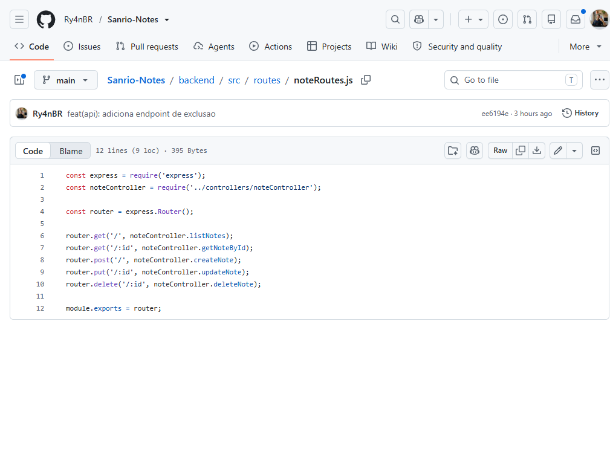
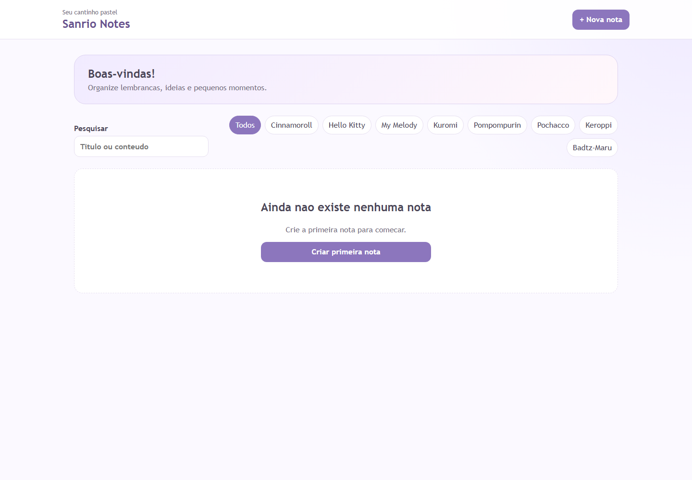
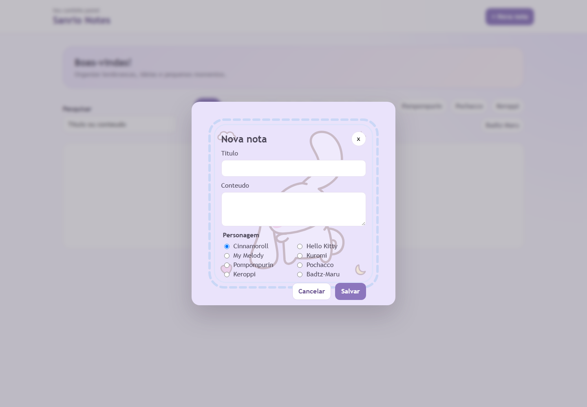
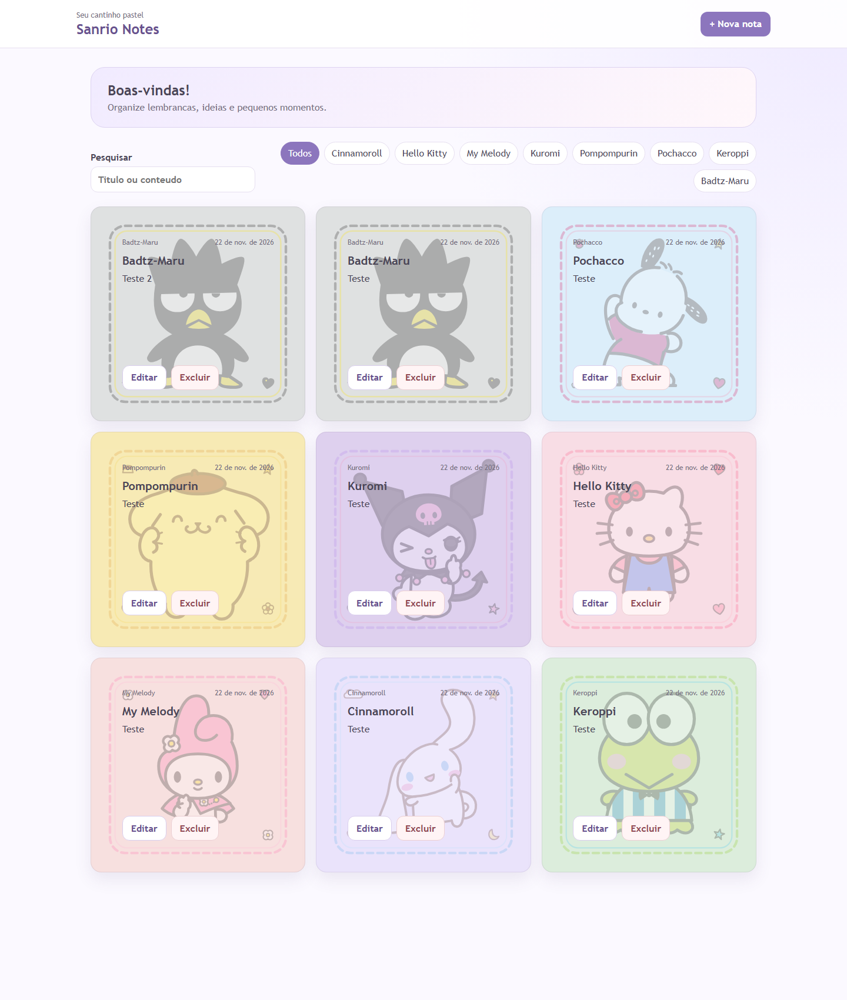
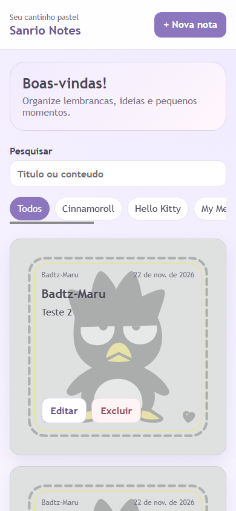
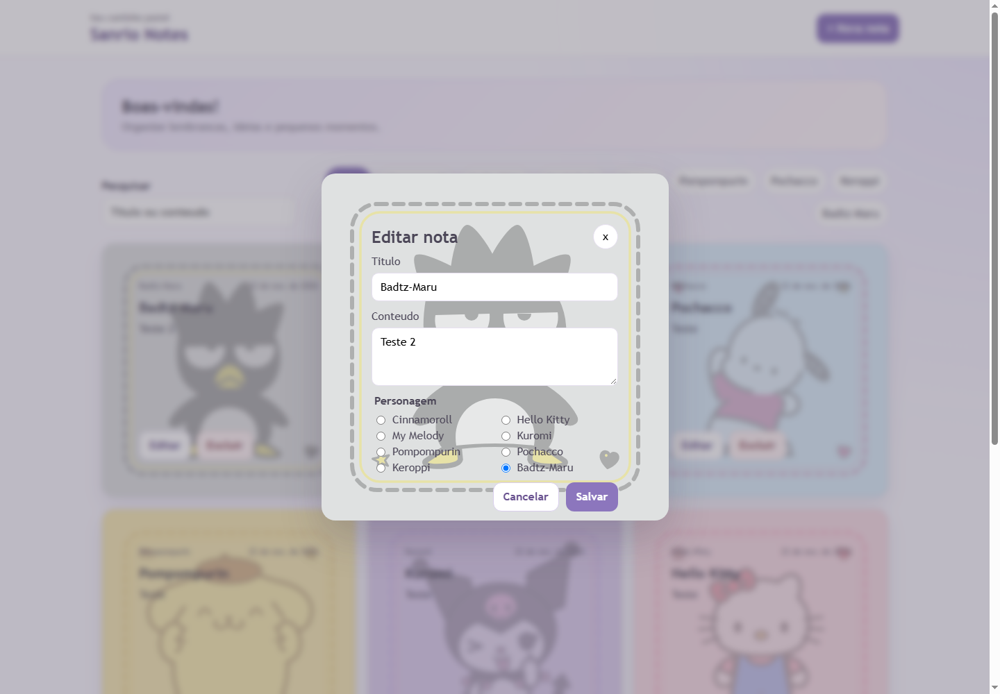
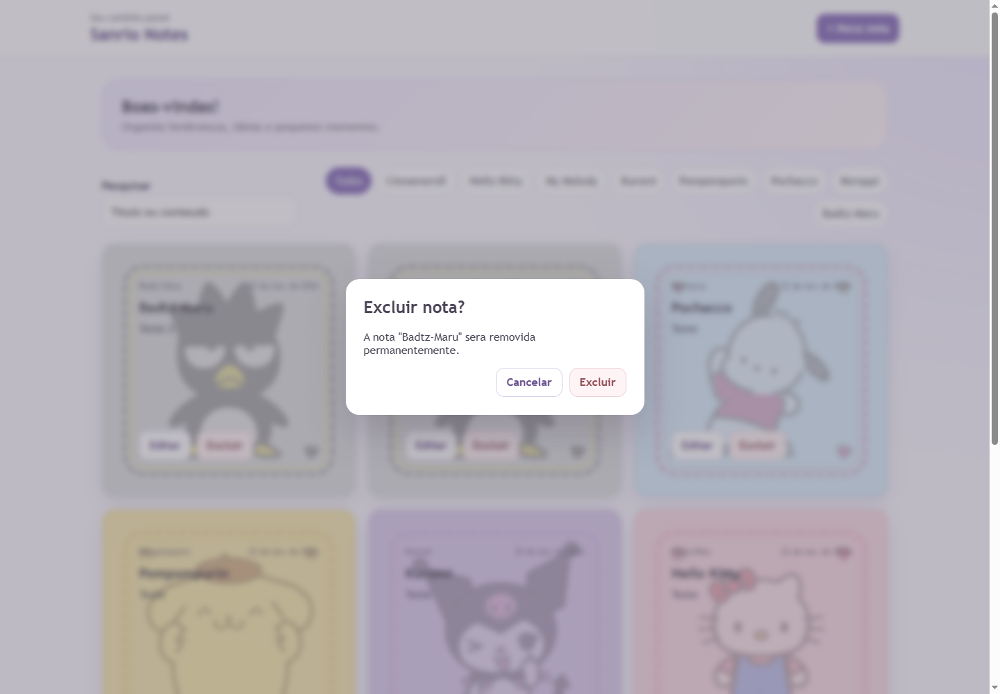
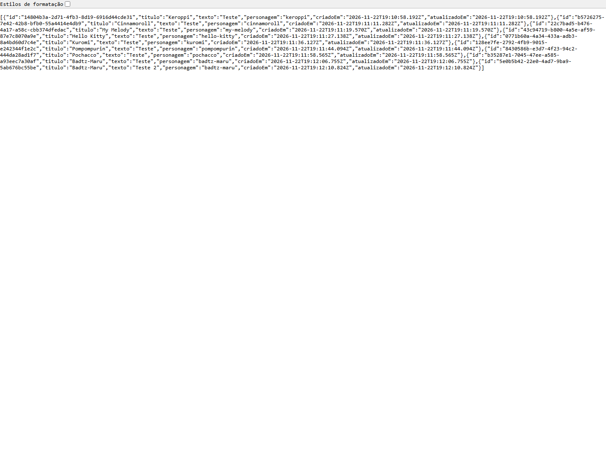
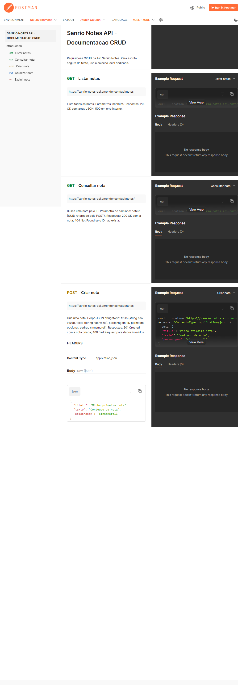
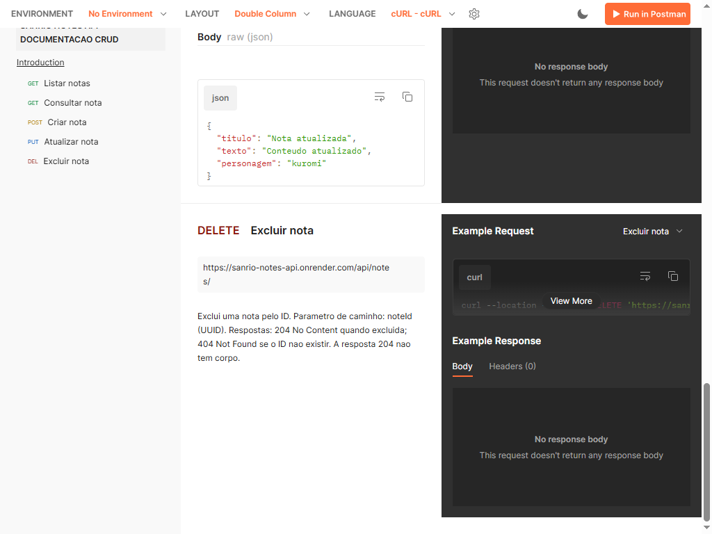

# Sanrio Notes — Relatório de entrega e auditoria

**Data da auditoria:** 22/11/2026

**Atividade Postman:** coleção e documentação preparadas; CRUD local validado. O envio ao Canva ainda depende de acesso à conta.

**Checklist geral do projeto:** **PRONTO COM RESSALVAS** — 65 de 82 critérios concluídos, 14 parciais e 3 não concluídos. A ressalva de testes React pertence ao checklist amplo e não é requisito do enunciado Postman apresentado.

## 1. Identificação do projeto

Sanrio Notes é uma aplicação didática de bloco de notas com API REST, interface React e persistência em arquivo JSON. O escopo e o checklist foram conferidos com o roteiro local `execucaoaula5.md` e com o [status do projeto](./STATUS_DO_PROJETO.md).

## 2. Resumo executivo

O backend e o frontend estão implementados e publicados. Os testes automatizados do backend e o build de produção do frontend passaram. Os oito SVGs carregam na aplicação publicada, e há capturas reais em [documentacao/evidencias/](./documentacao/evidencias/).

No checklist amplo do projeto, as ressalvas são: ausência de testes automatizados de frontend, componentes visuais concentrados em um único `App.jsx` e compartilhamento direto da coleção limitado pelo plano/permissões do workspace. Isso não deve ser confundido com o enunciado Postman: a documentação CRUD e a execução local isolada dessa atividade estão cobertas.

## 3. Objetivo e escopo da auditoria

Foram confrontados o roteiro de execução, o checklist final, o código, os testes existentes, a documentação, o histórico Git, os deploys e as evidências disponíveis. A auditoria não alterou nem excluiu notas existentes em produção.

`execucaoaula5.md` está disponível localmente, mas é ignorado pelo Git e não acompanha o repositório publicado. Os resultados abaixo refletem os arquivos e ambientes acessíveis nesta auditoria.

## 4. Critérios de classificação

- **Concluído:** implementação/documento/evidência correspondente foi encontrado e validado.
- **Parcial:** há implementação ou evidência, mas falta validação completa ou parte do requisito.
- **Não concluído:** o requisito está ausente ou contradito pela implementação/histórico.

Os 82 itens foram classificados individualmente na seção 11. “Parcial” não equivale a aceite integral.

## 5. Arquitetura e tecnologias

- **Frontend:** React 18 e Vite; build publicado na Vercel.
- **Backend:** Node.js e Express 4; API publicada no Render.
- **Persistência:** `backend/data.json`, sem banco de dados.
- **Integração:** o frontend utiliza `VITE_API_URL`; o backend controla origens permitidas com `CORS_ORIGIN`.
- **Coleção:** cinco requisições CRUD exportadas em [postman/sanrio-notes.postman_collection.json](./postman/sanrio-notes.postman_collection.json).
- **Documentação técnica do frontend:** [documentacao/frontend.md](./documentacao/frontend.md).

## 6. Backend e API

A API implementa health check, listagem, consulta por ID, criação, atualização, exclusão, validação e middleware de erros. Os testes de dados e CRUD estão em [backend/test/](./backend/test/) e são executados com `npm test` dentro de `backend/`.

Na validação adicional, entradas inválidas retornaram HTTP 400, ID inexistente retornou HTTP 404 e JSON malformado retornou HTTP 400. A exclusão responde HTTP 204 sem corpo. O [README do backend](./backend/README.md) documenta as rotas e o deploy.

## 7. Frontend e experiência

A interface inclui listagem, formulários, pesquisa, filtros por personagem, ordenação por atualização, estados de carregamento/vazio/erro, notificações e confirmação de exclusão. A implementação está concentrada em [frontend/src/App.jsx](./frontend/src/App.jsx), com catálogo, serviços e estilos separados em `frontend/src/`.

O catálogo aponta para os oito SVGs de `frontend/public/images/`; a aplicação publicada carregou cada arte. Editor e cartões mantêm a folha quadrada como fundo, com conteúdo em camada superior. A responsividade foi observada em 1440, 768 e 390 px.

Os nomes dos elementos visuais do roteiro não correspondem a componentes React independentes: a maior parte da UI está no `App.jsx`. Não há script nem suíte automatizada de testes de frontend no [package.json](./frontend/package.json).

## 8. Integração, dados e persistência

O frontend publicado acessa a API do Render e o CORS permite a origem da Vercel. Na captura da auditoria, a API de produção já continha nove notas genéricas; elas foram apenas consultadas e não foram criadas, editadas ou removidas durante este trabalho. O `backend/data.json` local não foi alterado pelos testes do backend.

O serviço Render Free não fornece disco persistente. Como os dados são gravados em arquivo JSON, não há garantia de que notas sobrevivam a reinícios ou novos deploys.

## 9. Testes e comandos executados

| Validação | Resultado |
|---|---|
| `npm test` em `backend/` | Aprovado; testes de dados e API/CRUD passaram. |
| Hash de `backend/data.json` antes/depois dos testes | Igual; os testes não alteraram o arquivo local. |
| `npm run build` em `frontend/` | Aprovado. |
| Casos de erro da API | Nota inválida 400; ID ausente 404; JSON malformado 400. |
| Vite local | Página inicial HTTP 200. |
| Produção: health e listagem | Render respondeu HTTP 200. |
| CORS de produção | Origem `https://sanrio-notes.vercel.app` aceita pela API. |
| Recursos SVG | Oito URLs servidas e as ilustrações carregadas na interface. |
| Interface responsiva | Verificada visualmente em 1440, 768 e 390 px, sem overflow horizontal da página. |
| Coleção Postman local (Newman) | 6 requisições, 10 asserções, 0 falhas; criação, leitura, atualização, exclusão e verificação de 404 executadas contra uma cópia temporária da API. |
| Documentação Postman pública | URL abriu e apresentou as cinco operações CRUD da coleção publicada. |

Não foi concluído um fluxo ponta a ponta de criação, gravação de edição e exclusão pela interface React; isso não faz parte do enunciado Postman apresentado. O CRUD da API HTTP foi executado isoladamente pela coleção Postman local. Não foram feitas escritas na API de produção.

## 10. Resultado dos deploys

- **Frontend:** [https://sanrio-notes.vercel.app](https://sanrio-notes.vercel.app) — HTTP 200.
- **API:** [https://sanrio-notes-api.onrender.com](https://sanrio-notes-api.onrender.com) — `/health` e `/api/notes` responderam HTTP 200.
- **CORS:** a API respondeu com a origem da Vercel permitida.
- **Persistência:** sujeita à limitação do plano Render Free descrita na seção 8.

## 11. Checklist final de aceite — 82 critérios

### 11.1 API (19 critérios)

| # | Critério | Status | Evidência |
|---:|---|---|---|
| 1 | Projeto Node inicializado | Concluído | [backend/package.json](./backend/package.json) |
| 2 | Express instalado | Concluído | [backend/package.json](./backend/package.json) |
| 3 | CORS configurado | Concluído | [backend/server.js](./backend/server.js), teste de CORS em produção |
| 4 | JSON inicial válido | Concluído | `backend/data.json`; testes de dados |
| 5 | Módulo de leitura | Concluído | [backend/src/](./backend/src/) |
| 6 | Módulo de gravação | Concluído | [backend/src/](./backend/src/) |
| 7 | Catálogo de personagens | Concluído | [backend/src/](./backend/src/) |
| 8 | Validação de dados | Concluído | [backend/src/](./backend/src/); inválido → 400 |
| 9 | Serviço de notas | Concluído | [backend/src/](./backend/src/) |
| 10 | Controller de notas | Concluído | [backend/src/](./backend/src/) |
| 11 | Rotas CRUD | Concluído | [backend/server.js](./backend/server.js); [backend/test/api.test.js](./backend/test/api.test.js) |
| 12 | Middleware de erros | Concluído | [backend/src/](./backend/src/) |
| 13 | Testes de leitura | Concluído | [backend/test/data.test.js](./backend/test/data.test.js) |
| 14 | Testes de listagem e consulta | Concluído | [backend/test/api.test.js](./backend/test/api.test.js) |
| 15 | Testes de criação | Concluído | [backend/test/api.test.js](./backend/test/api.test.js) |
| 16 | Testes de atualização | Concluído | [backend/test/api.test.js](./backend/test/api.test.js) |
| 17 | Testes de exclusão | Concluído | [backend/test/api.test.js](./backend/test/api.test.js) |
| 18 | README do backend | Concluído | [backend/README.md](./backend/README.md) |
| 19 | Deploy Render validado | Concluído | [API publicada](https://sanrio-notes-api.onrender.com/health) |

### 11.2 Frontend (37 critérios)

| # | Critério | Status | Evidência |
|---:|---|---|---|
| 20 | React/Vite inicializado | Concluído | [frontend/package.json](./frontend/package.json) |
| 21 | Estrutura de pastas documentada | Concluído | [frontend/README.md](./frontend/README.md), [documentacao/frontend.md](./documentacao/frontend.md) |
| 22 | Tokens de cores | Concluído | [frontend/src/styles/](./frontend/src/styles/) |
| 23 | Tipografia | Concluído | [frontend/src/styles/](./frontend/src/styles/) |
| 24 | Estilos globais | Concluído | [frontend/src/styles/](./frontend/src/styles/) |
| 25 | Catálogo de personagens | Concluído | [frontend/src/data/characters.js](./frontend/src/data/characters.js) |
| 26 | Oito ilustrações locais | Concluído | [frontend/public/images/](./frontend/public/images/) |
| 27 | Header como componente | Parcial | Header existe no JSX, mas não é componente React independente; [App.jsx](./frontend/src/App.jsx) |
| 28 | MainLayout como componente | Parcial | Estrutura existe no JSX, sem componente independente; [App.jsx](./frontend/src/App.jsx) |
| 29 | Button como componente | Parcial | Botões são elementos inline, sem componente compartilhado; [App.jsx](./frontend/src/App.jsx) |
| 30 | SearchBar como componente | Parcial | Pesquisa implementada inline; [App.jsx](./frontend/src/App.jsx) |
| 31 | CharacterFilter como componente | Parcial | Filtro implementado inline; [App.jsx](./frontend/src/App.jsx) |
| 32 | NoteCard como componente | Parcial | Cartões implementados inline; [App.jsx](./frontend/src/App.jsx) |
| 33 | NoteList como componente | Parcial | Listagem implementada inline; [App.jsx](./frontend/src/App.jsx) |
| 34 | NoteForm como componente | Parcial | Formulário implementado inline; [App.jsx](./frontend/src/App.jsx) |
| 35 | Modal como componente | Parcial | Modais implementados inline; [App.jsx](./frontend/src/App.jsx) |
| 36 | Cliente HTTP | Concluído | [frontend/src/services/](./frontend/src/services/) |
| 37 | Serviços CRUD | Concluído | [frontend/src/services/noteService.js](./frontend/src/services/noteService.js) |
| 38 | Estado de notas | Concluído | [App.jsx](./frontend/src/App.jsx) |
| 39 | LoadingState | Concluído | [App.jsx](./frontend/src/App.jsx) |
| 40 | EmptyState | Concluído | [App.jsx](./frontend/src/App.jsx) |
| 41 | Toast | Concluído | [App.jsx](./frontend/src/App.jsx) |
| 42 | Criação pela interface validada | Parcial | Código implementado, mas não foi concluído teste ponta a ponta de gravação; [App.jsx](./frontend/src/App.jsx) |
| 43 | Listagem | Concluído | Captura real [listagem](./documentacao/evidencias/listagem-cartoes-producao.png) |
| 44 | Edição pela interface validada | Parcial | Modal de edição foi aberto, sem salvar; [captura](./documentacao/evidencias/edicao-nota-producao.png) |
| 45 | Exclusão pela interface validada | Parcial | Confirmação foi aberta e cancelada; [captura](./documentacao/evidencias/confirmacao-exclusao-producao.png) |
| 46 | Pesquisa | Concluído | Código e validação visual em produção; [App.jsx](./frontend/src/App.jsx) |
| 47 | Filtro | Concluído | Código e validação visual em produção; [App.jsx](./frontend/src/App.jsx) |
| 48 | Ordenação | Concluído | Ordenação por data no código; [App.jsx](./frontend/src/App.jsx) |
| 49 | Responsividade | Concluído | [captura mobile](./documentacao/evidencias/responsivo-mobile-producao.png) |
| 50 | Acessibilidade | Parcial | Semântica/labels presentes; auditoria completa com teclado/leitor de tela não executada; [App.jsx](./frontend/src/App.jsx) |
| 51 | Testes automatizados de frontend | Não concluído | Não há script ou suíte de testes; [frontend/package.json](./frontend/package.json) |
| 52 | Build | Concluído | `npm run build` aprovado |
| 53 | README do frontend | Concluído | [frontend/README.md](./frontend/README.md) |
| 54 | Documentação técnica | Concluído | [documentacao/frontend.md](./documentacao/frontend.md) |
| 55 | Documentação visual | Concluído | [documentacao/identidade-visual.md](./documentacao/identidade-visual.md) |
| 56 | Deploy Vercel validado | Concluído | [Aplicação publicada](https://sanrio-notes.vercel.app) |

### 11.3 Postman e entrega (15 critérios)

| # | Critério | Status | Evidência |
|---:|---|---|---|
| 57 | Coleção criada | Concluído | [Coleção JSON](./postman/sanrio-notes.postman_collection.json) |
| 58 | GET geral | Concluído | Coleção e resposta de produção: [captura](./documentacao/evidencias/api-listagem-producao.png) |
| 59 | GET por ID | Concluído | Requisição presente na coleção; API retorna 404 para ID inexistente |
| 60 | POST | Concluído | Requisição e teste automatizado local em [api.test.js](./backend/test/api.test.js) |
| 61 | PUT | Concluído | Requisição e teste automatizado local em [api.test.js](./backend/test/api.test.js) |
| 62 | DELETE | Concluído | Requisição e teste automatizado local em [api.test.js](./backend/test/api.test.js) |
| 63 | Parâmetros descritos | Concluído | `baseUrl`, `noteId`, campos JSON e fluxo de execução descritos em [postman/README.md](./postman/README.md) |
| 64 | Códigos HTTP descritos | Concluído | HTTP 200, 201, 204, 400 e 404 descritos na documentação e nas requisições da [coleção](./postman/sanrio-notes.postman_collection.json) |
| 65 | Testes Postman executados | Concluído | [Coleção CRUD local](./postman/sanrio-notes-local.postman_collection.json): 6 requisições, 10 asserções, 0 falhas, backend temporário isolado |
| 66 | Coleção exportada | Concluído | [sanrio-notes.postman_collection.json](./postman/sanrio-notes.postman_collection.json) |
| 67 | Link compartilhável validado | Concluído | [Documentação CRUD pública](https://documenter.getpostman.com/view/52845937/2sBYPv3CLw) abre e descreve as cinco requisições |
| 68 | Documento final criado | Concluído | Este [ENTREGA.md](./ENTREGA.md) |
| 69 | Quatro questões respondidas | Concluído | Seção 16 e [documentacao/entrega.md](./documentacao/entrega.md) |
| 70 | Prints reais inseridos | Concluído | [Evidências](./documentacao/evidencias/) |
| 71 | GitHub, Render, Vercel e Postman documentados | Concluído | Seções 10, 12 e 13 |

### 11.4 Git (11 critérios)

| # | Critério | Status | Evidência |
|---:|---|---|---|
| 72 | Cada criação independente tem commit próprio | Parcial | Histórico incremental, mas a interface foi agrupada em um commit |
| 73 | Cada componente criado tem commit próprio | Não concluído | A interface está concentrada em `App.jsx`; não há um commit por componente |
| 74 | Cada arquivo de ilustração tem commit próprio | Concluído | Histórico inclui commits individuais para os oito SVGs |
| 75 | Serviços/rotas/controllers têm commits pequenos | Concluído | Histórico mostra alterações separadas de serviço, controller e rotas |
| 76 | Testes foram commitados em etapas próprias | Concluído | Commits separados de testes de dados e API |
| 77 | Documentação foi commitada incrementalmente | Concluído | Histórico contém commits específicos de documentação |
| 78 | Nenhum commit agrupa o frontend inteiro | Não concluído | `97ba823 feat(frontend): integra interface completa e crud` agrupa a interface |
| 79 | Nenhum commit agrupa o CRUD inteiro | Concluído | Histórico do backend separa endpoints, controllers e serviços |
| 80 | Nenhum segredo foi versionado | Concluído | Revisão do histórico e dos arquivos versionados não encontrou segredo |
| 81 | Histórico revisado | Concluído | Histórico Git inspecionado |
| 82 | Branch publicada no GitHub | Concluído | [Repositório](https://github.com/Ry4nBR/Sanrio-Notes) |

**Contagem:** API 19/19 concluídos; frontend 23 concluídos, 13 parciais e 1 não concluído; Postman/entrega 15/15 concluídos; Git 8 concluídos, 1 parcial e 2 não concluídos. **Total: 65 concluídos, 14 parciais, 3 não concluídos.**

## 12. Publicações e links

- Código: [GitHub — Ry4nBR/Sanrio-Notes](https://github.com/Ry4nBR/Sanrio-Notes).
- API: [Render](https://sanrio-notes-api.onrender.com).
- Interface: [Vercel](https://sanrio-notes.vercel.app).
- Documentação da coleção: [Postman](https://documenter.getpostman.com/view/52845937/2sBYPv3CLw).
- Arquivo exportado: [coleção Postman](./postman/sanrio-notes.postman_collection.json).
- Teste CRUD isolado: [coleção Postman local automatizada](./postman/sanrio-notes-local.postman_collection.json).
- Documento focado na atividade: [documentacao/entrega-canva.md](./documentacao/entrega-canva.md).

## 13. Estado do Postman

A página pública da documentação foi validada por HTTP 200 e apresenta as cinco requisições CRUD da coleção principal. Ela não deve ser confundida com uma coleção listada/disponível para importação pública na Public API Network. O compartilhamento direto exigiu plano pago e a mudança para workspace público não estava autorizada para o papel atual. Nenhum upgrade ou trial foi iniciado. Os testes com escrita foram executados apenas contra uma cópia temporária do backend.

## 14. Capturas e evidências reais

As imagens abaixo foram capturadas da aplicação publicada. A tela inicial e o editor representam estados sem nota selecionada. A listagem apresenta nove notas genéricas que já existiam na API no momento da captura; a auditoria não as criou nem alterou.

| Evidência | Captura |
|---|---|
| Código das rotas CRUD |  |
| Tela inicial |  |
| Editor de nova nota |  |
| Cartões existentes |  |
| Layout mobile |  |
| Editor de edição (sem salvar) |  |
| Confirmação de exclusão (cancelada) |  |
| Resposta de listagem da API |  |
| Postman: leitura e criação |  |
| Postman: atualização e exclusão |  |

As telas de edição e exclusão mostram apenas os diálogos: ambos foram cancelados para preservar os dados. A resposta da API foi capturada como JSON minificado; não é uma resposta de exemplo formatada ou inventada.

## 15. Segurança e limitações operacionais

- A API não tem autenticação/autorização; CORS restringe origens de navegador, mas não substitui autenticação.
- Escritas em arquivo JSON não são apropriadas para concorrência ou escala e não têm garantia de persistência no Render Free.
- Não executar CRUD de escrita em produção sem autorização e dados de teste descartáveis.
- Não foram encontrados segredos versionados na revisão do histórico.

## 16. Respostas às quatro questões técnicas

1. **Segurança:** sem autenticação, um cliente autorizado pela API pode alterar notas; CORS não impede chamadas diretas. Evolução recomendada: autenticação/autorização, validação, limitação de requisições e logs sem dados sensíveis.
2. **Persistência JSON:** é simples para o exercício, mas leitura/gravação integral, concorrência, integridade e ausência de disco persistente no plano atual limitam seu uso. Um banco de dados e armazenamento persistente seriam necessários para produção.
3. **Dez mil registros:** carregar e regravar o arquivo inteiro aumentaria latência, memória e risco de perda/concorrência. Seriam necessários paginação, índices, operações concorrentes seguras e migração para banco de dados.
4. **Arquitetura:** separar a UI em componentes e a API em rotas, controllers, serviços e módulos de dados melhora manutenção/testabilidade. A API já está separada; o frontend permanece concentrado em `App.jsx`.

## 17. Pendências

1. Importar o [documento preparado](./documentacao/entrega-canva.md) para a conta Canva e enviar a atividade. O conteúdo inclui as capturas do código, da aplicação e do Postman, além dos links.
2. Separar os componentes do frontend caso isso seja exigência formal do roteiro.
3. Como etapa opcional, habilitar compartilhamento direto ou listagem na Public API Network se o instrutor exigir; o link público da documentação já atende ao enunciado enviado.
4. Se necessária persistência real, migrar do arquivo JSON/Render Free para armazenamento persistente.
5. Versionar o roteiro `execucaoaula5.md` somente se houver autorização para remover sua exclusão do Git.

## 18. Conclusão

O sistema está funcional, publicado e respaldado por testes de backend, build de frontend e evidências reais. A classificação geral é **PRONTO COM RESSALVAS**, não “100% concluído”: os três itens não concluídos e os 18 parciais devem ser resolvidos ou aceitos explicitamente antes de declarar o checklist integralmente atendido.
