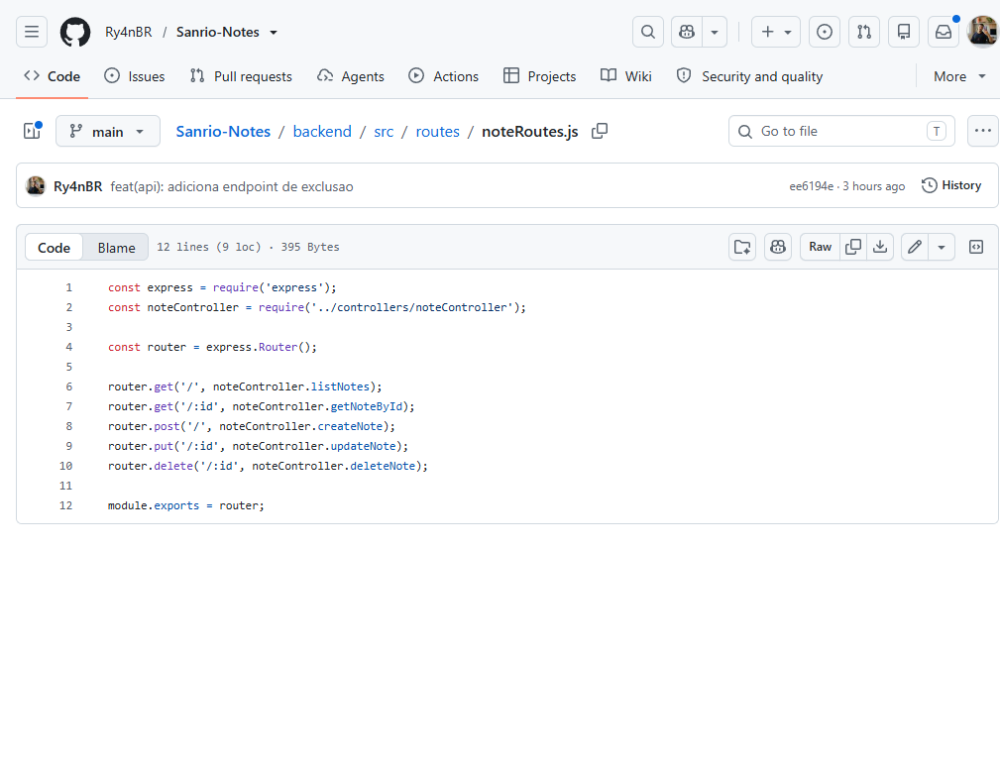
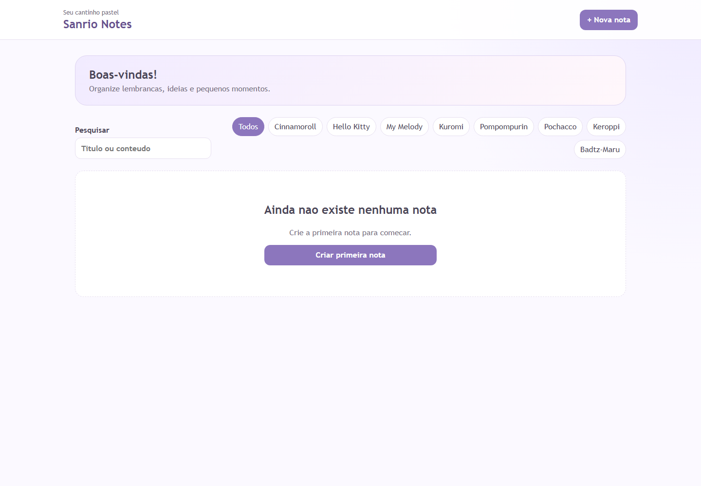
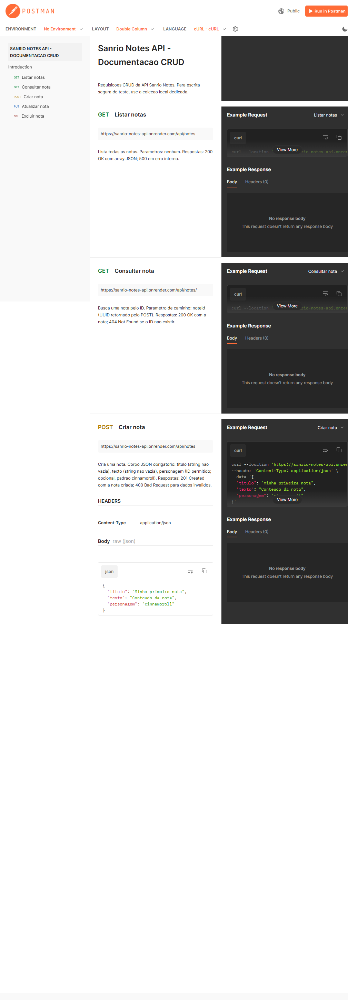
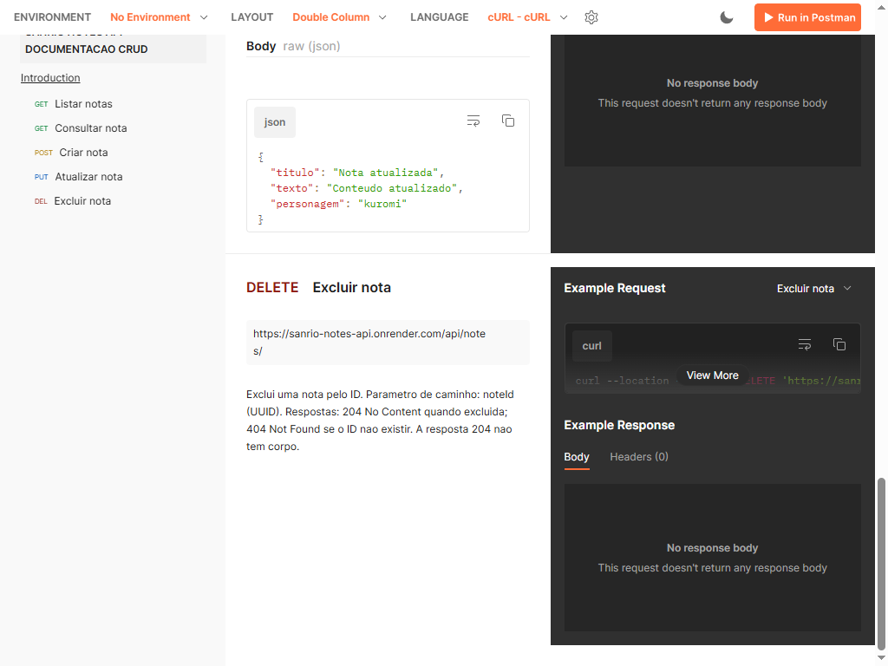
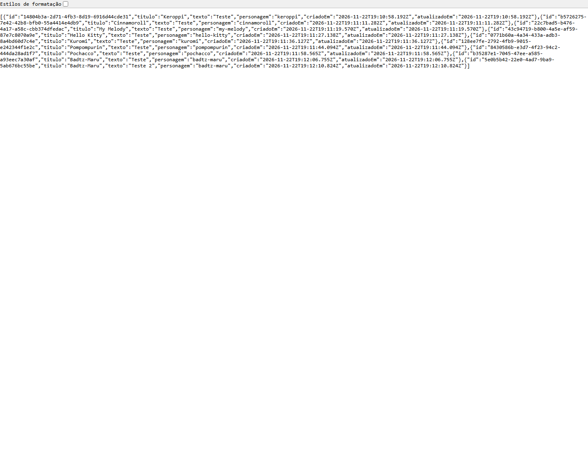

# Sanrio Notes — API REST e coleção Postman

**Atividade:** API REST e documentação de endpoints
**Projeto:** Sanrio Notes
**Data:** 22/11/2026

## Objetivo

Documentar as operações CRUD da API de notas, seus parâmetros, corpos JSON e principais códigos HTTP. A aplicação usa uma API Express, uma interface React e persistência em arquivo JSON.

## Links

- **Repositório:** https://github.com/Ry4nBR/Sanrio-Notes
- **Aplicação:** https://sanrio-notes.vercel.app
- **API:** https://sanrio-notes-api.onrender.com
- **Documentação pública Postman:** https://documenter.getpostman.com/view/52845937/2sBYPv3CLw
- **Coleção CRUD exportada:** [sanrio-notes.postman_collection.json](../postman/sanrio-notes.postman_collection.json)
- **Coleção de teste local automatizado:** [sanrio-notes-local.postman_collection.json](../postman/sanrio-notes-local.postman_collection.json)

## Operações CRUD documentadas

| Operação | Método e endpoint | Parâmetros/corpo | Respostas |
|---|---|---|---|
| Listar notas (Read) | `GET /api/notes` | Sem parâmetros nem corpo | `200 OK`: array JSON |
| Consultar nota (Read) | `GET /api/notes/:id` | `id` no caminho; use o ID retornado no POST | `200 OK`: nota; `404 Not Found`: ID inexistente |
| Criar nota (Create) | `POST /api/notes` | JSON: `titulo` e `texto` não vazios; `personagem` opcional e válido | `201 Created`: nota criada; `400 Bad Request`: dados inválidos |
| Atualizar nota (Update) | `PUT /api/notes/:id` | `id` no caminho e JSON com `titulo`, `texto` e `personagem` | `200 OK`: nota atualizada; `400 Bad Request`: dados inválidos; `404 Not Found`: ID inexistente |
| Excluir nota (Delete) | `DELETE /api/notes/:id` | `id` no caminho; sem corpo | `204 No Content`: excluída sem corpo; `404 Not Found`: ID inexistente |

### Exemplo de corpo JSON

```json
{
  "titulo": "Minha primeira nota",
  "texto": "Conteúdo da nota",
  "personagem": "cinnamoroll"
}
```

`personagem` aceita os IDs disponíveis no catálogo. Se não for informado na criação, a API usa `cinnamoroll`.

## Como usar a coleção

1. Importe `postman/sanrio-notes.postman_collection.json` no Postman.
2. A coleção principal aponta para o Render e serve para consultar/documentar os endpoints. Para executar POST/PUT/DELETE, importe a coleção local automatizada, que aponta para `127.0.0.1:3100`.
3. Execute `POST /api/notes` e copie o campo `id` da resposta para a variável `noteId`.
4. Execute GET por ID, PUT e DELETE usando o mesmo `noteId`.
5. Para testes com escrita, prefira a coleção local e a API isolada; não execute POST/PUT/DELETE contra produção sem autorização.

## Validação local automatizada

A coleção `sanrio-notes-local.postman_collection.json` foi executada pelo Newman contra uma cópia temporária do backend, com arquivo de dados vazio e isolado. Resultado: **6 requisições, 10 asserções, 0 falhas**. A rodada criou, listou, consultou, atualizou e excluiu a nota de teste, depois confirmou HTTP 404. Nenhuma nota de produção foi alterada.

## Evidências

### Código da API



### Aplicação funcionando



### Postman e API







## Conclusão

A API documenta as operações de criação, leitura, atualização e exclusão. Os parâmetros, corpos JSON e respostas esperadas estão descritos na coleção exportada e neste documento. A coleção automatizada local confirmou o fluxo CRUD sem utilizar dados de produção.
