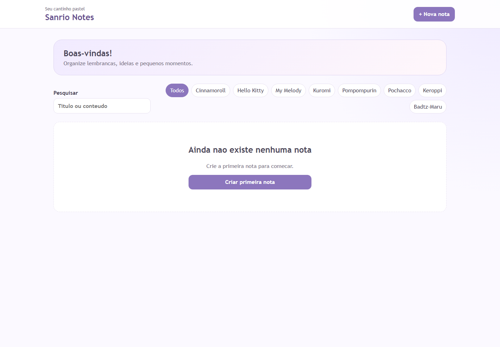
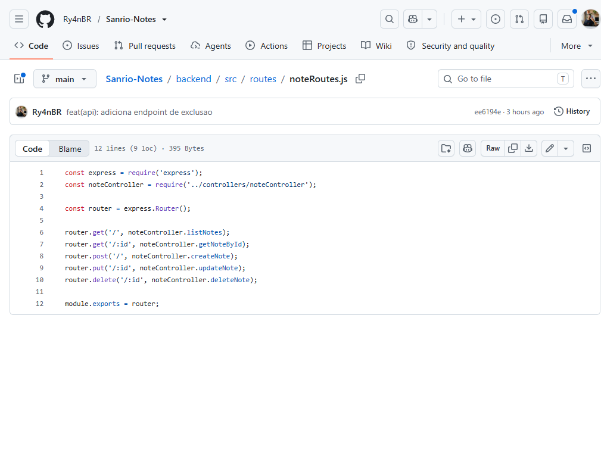
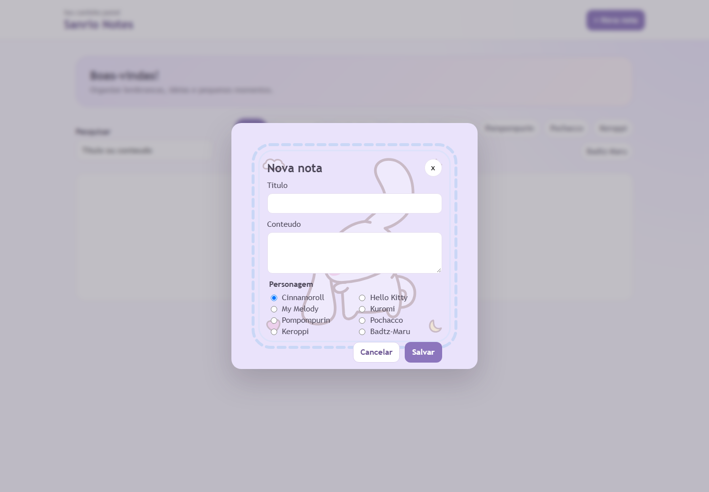
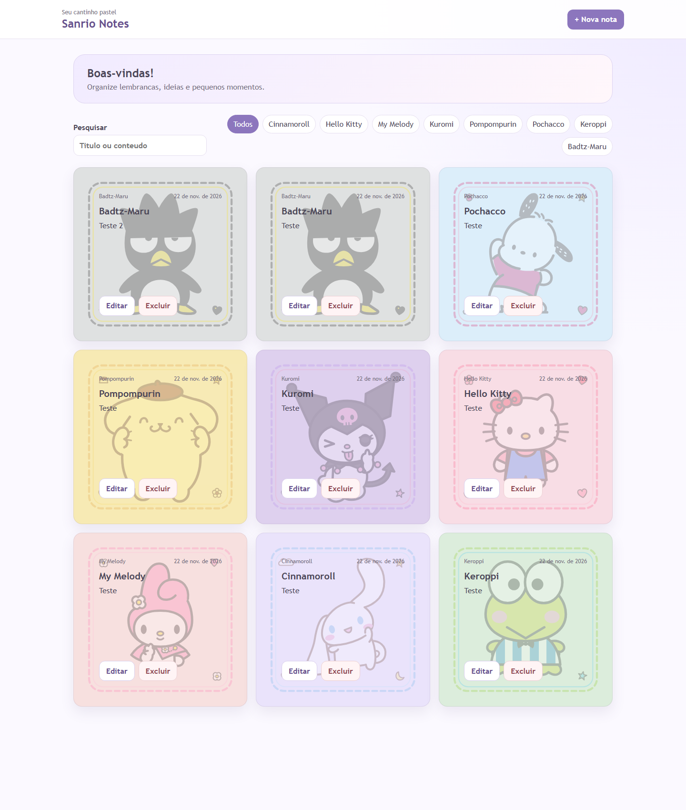
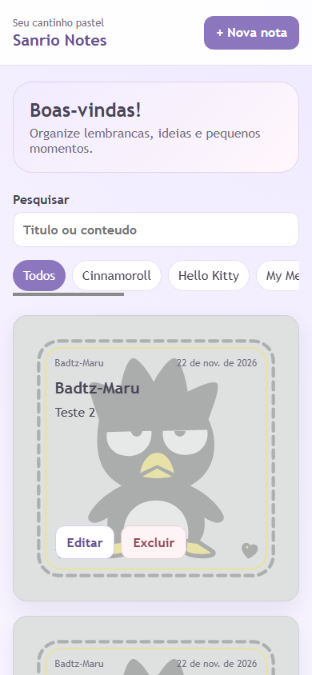
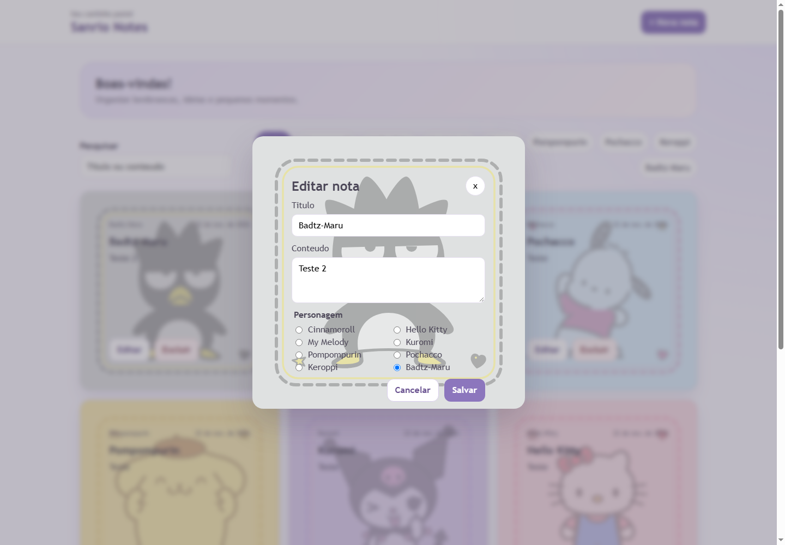
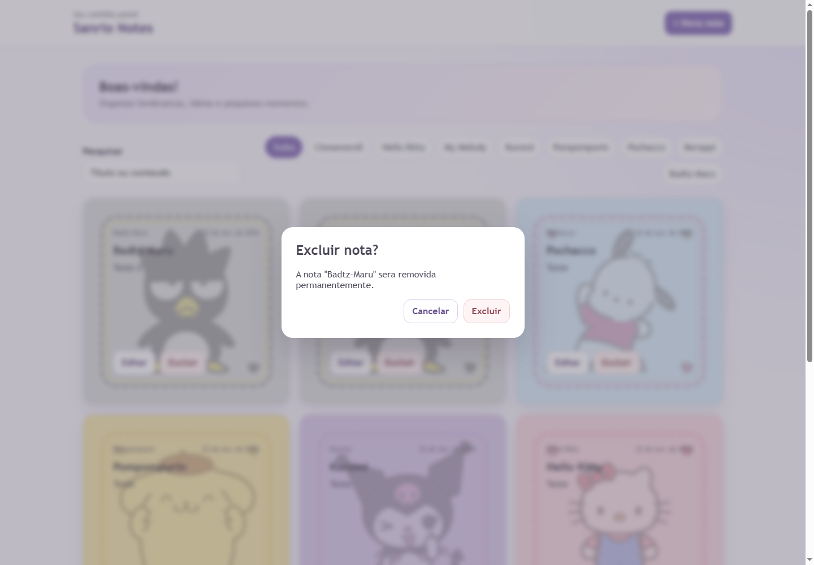
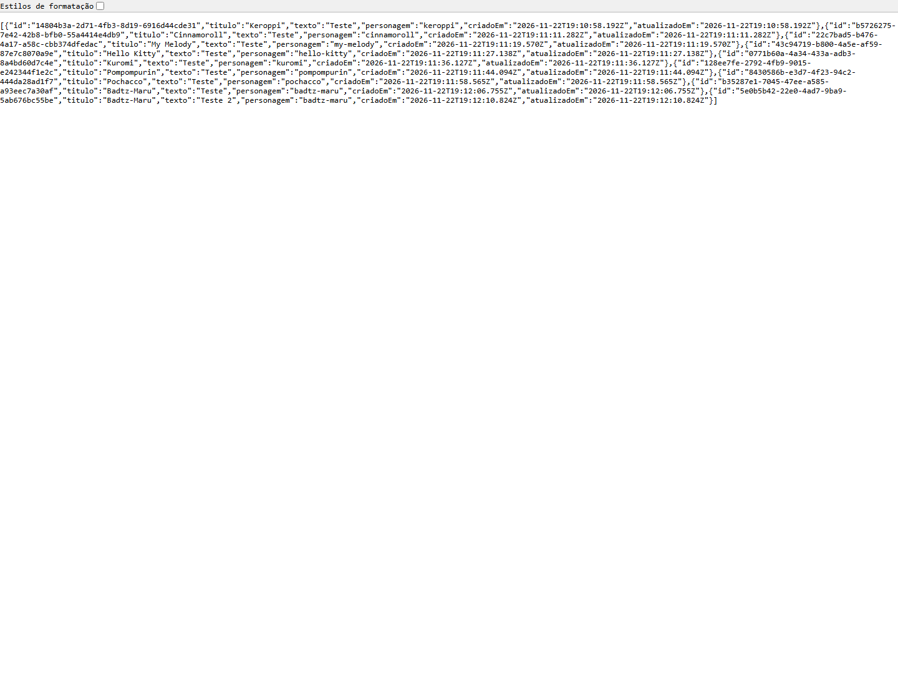
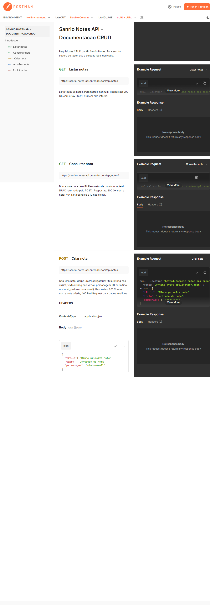
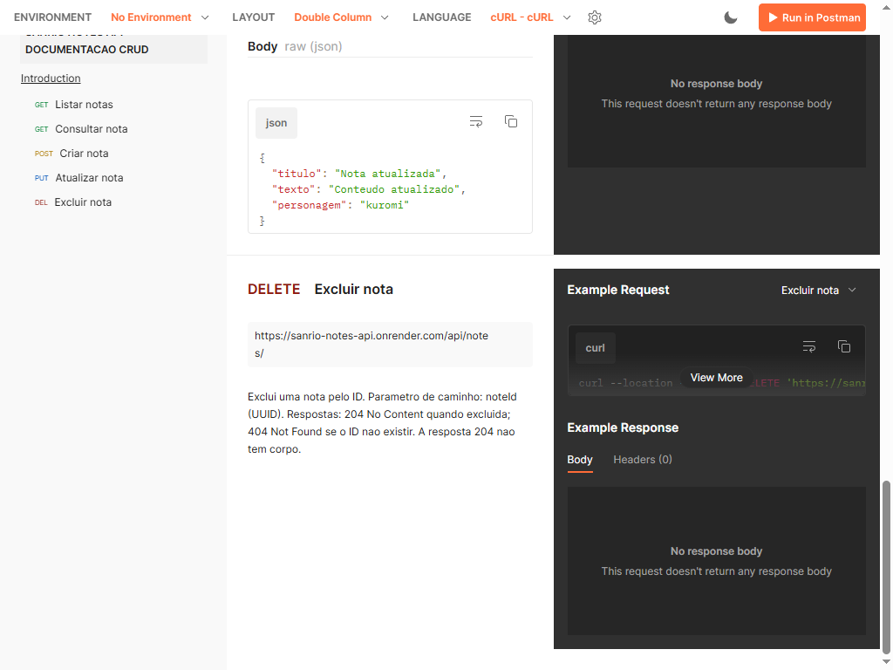

# Sanrio Notes - Documento de entrega

> Para a auditoria completa, o checklist de 82 critérios e todas as evidências, consulte o [relatório principal](../ENTREGA.md).

## Objetivo

Aplicacao de bloco de notas com API REST Express, front-end React e persistencia em JSON.

## Links

- GitHub: https://github.com/Ry4nBR/Sanrio-Notes
- Render (API): https://sanrio-notes-api.onrender.com
- Vercel (aplicacao): https://sanrio-notes.vercel.app
- Documentacao publica Postman: https://documenter.getpostman.com/view/52845937/2sBYPv3CLw
- Arquivo da colecao: `../postman/sanrio-notes.postman_collection.json`

## Evidencias de aceite

Capturas reais da aplicação publicada:

Na captura da listagem havia nove notas genéricas já existentes na API. A auditoria não as criou, editou ou excluiu. As ações de edição e exclusão foram canceladas.

## Segurança

O projeto possui CORS restrito a origens configuradas, mas ainda nao possui autenticacao, portanto qualquer origem permitida pode alterar os dados. Os principais riscos sao acesso indevido, abuso de requisicoes, concorrencia nas escritas do JSON e exposicao de dados. Devem ser mitigados com autenticação/autorização, validação rigorosa, limites de requisição, logs sem dados sensíveis, backup e uso de banco de dados em produção.

## JSON em produção

`data.json` e simples de inspecionar e adequado ao exercicio didatico. Em produção real, gravação integral, concorrencia, integridade e escalabilidade sao limitacoes. Um banco de dados seria mais adequado para multiusuario.

## Dez mil registros

Com 10 mil notas, leitura e escrita integral aumentam memoria, latencia e risco de perda por concorrencia. Seriam necessarios índices, filtros paginados, escrita concorrente segura e migracao para banco de dados.

## Arquitetura

Concentrar toda a lógica em `server.js` mistura inicializacao, rotas e regras de negocio. A separacao em routes, controllers, validators, services, middlewares e modulo de dados melhora testes e manutencao.

## Limitacoes

- O plano Free do Render nao fornece disco persistente; notas gravadas em `data.json` podem nao sobreviver a reinicios ou novos deploys.
- O compartilhamento direto da colecao Postman e a listagem na Public API Network dependem de plano ou permissoes indisponiveis no workspace atual. A documentacao publica acima esta acessivel.
